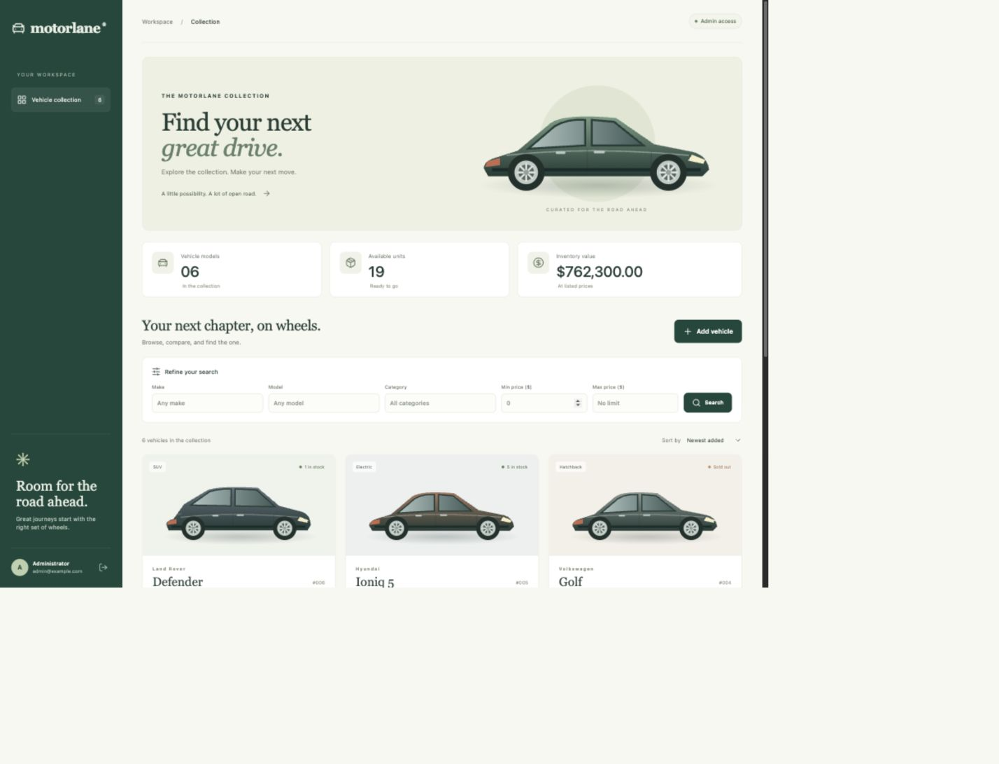
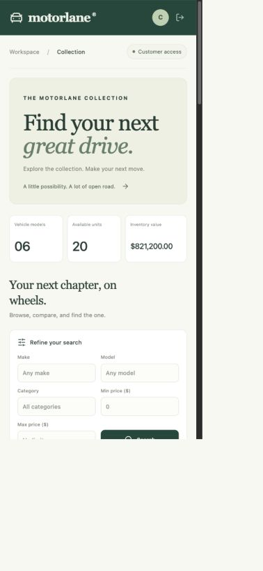
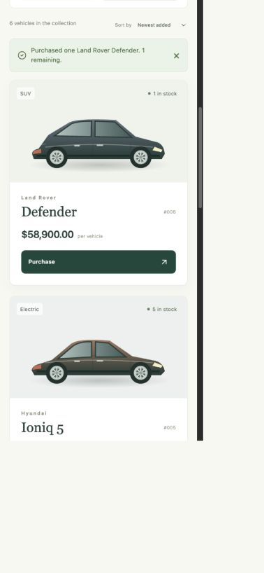

# Motorlane — Car Dealership Inventory

A complete local implementation of the Incubyte car dealership kata: a FastAPI REST API, persistent SQLite database, and responsive React + TypeScript + Tailwind interface.

Customers can register, sign in, search the collection, and purchase one vehicle at a time. Administrators can add vehicles, edit their details, replenish stock, and delete listings. The backend enforces permissions and stock constraints independently of the interface.



## Quick start

Requirements: **Python 3.12**, **Node.js 22.12 or newer**, npm, and Git. Python must include SQLite 3.35 or newer, as the repository uses `RETURNING` clauses. Python 3.12 normally includes a compatible version.

### 1. Start the backend

From the project root:

```sh
cd backend
python3 -m venv .venv
source .venv/bin/activate
python -m pip install -r requirements.txt
python -c "from pathlib import Path; import secrets; p=Path('.env'); p.exists() or p.write_text('JWT_SECRET='+secrets.token_urlsafe(48)+'\nDATABASE_PATH=./inventory.db\nFRONTEND_ORIGIN=http://localhost:5173\n')"
python -m app.cli seed
python -m uvicorn app.main:create_app --factory --host 127.0.0.1 --port 8000 --reload
```

On Windows, use `python` instead of `python3`, and activate the environment with `.venv\Scripts\Activate.ps1` in PowerShell. Run backend commands from the `backend` directory so `.env` and the relative database path resolve consistently.

The secret-generation command creates `.env` only if it does not already exist. If you copied `.env.example` yourself, replace its placeholder with a random secret of at least 32 characters. The server deliberately rejects the example placeholder.

The seed command adds six illustrative vehicles only when the inventory is empty. It creates **no user accounts**. Prices and stock are demonstration data, not real market quotations. Omitting this command starts with an empty inventory.

API: <http://localhost:8000/api/health> · interactive API documentation: <http://localhost:8000/docs>

### 2. Start the frontend

In a second terminal, from the project root:

```sh
cd frontend
npm ci
npm run dev
```

Open **<http://localhost:5173>**. Vite proxies `/api` to the backend on port 8000.

### 3. Create an administrator

Register your account using **Create account** in the UI. All registrations create customers. In another terminal, with the backend environment activated:

```sh
cd backend
python -m app.cli promote your-email@example.com
```

Use the email you actually registered. Sign out and sign in again to refresh the UI role. The backend checks the database role on every request, so permissions change immediately. Administrative promotion is a local operator command; no public API can grant admin access.

## Features

- Registration and login with Argon2id password hashing and signed, expiring JWT bearer tokens.
- Persistent, file-backed SQLite storage, including after application restarts.
- Vehicle creation, listing, editing, deletion, searching, purchasing, and restocking.
- Combined make, model, category, minimum-price, and maximum-price filters.
- Responsive dashboard, sorting, loading states, empty states, validation feedback, and notifications.
- Disabled purchase controls for sold-out vehicles and protection against repeated clicks while a request is pending.
- Accessible form labels, native modal focus handling, keyboard controls, and reduced-motion support.
- Original SVG vehicle illustrations; no third-party vehicle photos or copied application templates.
- Backend tests, React interaction tests, browser test specifications, CI configuration, and a Docker deployment option.

## API reference

All vehicle endpoints require `Authorization: Bearer <access_token>`. Authentication endpoints accept JSON.

| Method | Path | Access | Result |
| --- | --- | --- | --- |
| POST | `/api/auth/register` | Public | Create customer; return token and safe user profile |
| POST | `/api/auth/login` | Public | Return token and safe user profile |
| GET | `/api/auth/me` | Signed in | Current user profile |
| GET | `/api/health` | Public | Health status |
| GET | `/api/vehicles` | Signed in | All vehicle listings, including sold-out listings |
| GET | `/api/vehicles/search` | Signed in | Combined, case-insensitive substring filters and inclusive price bounds |
| POST | `/api/vehicles` | Admin | Add vehicle with initial quantity |
| PUT | `/api/vehicles/{id}` | Admin | Replace make, model, category, and price |
| DELETE | `/api/vehicles/{id}` | Admin | Delete listing; return 204 |
| POST | `/api/vehicles/{id}/purchase` | Signed in | Purchase one unit; return updated listing |
| POST | `/api/vehicles/{id}/restock` | Admin | Add stock; return updated listing |

Registration/login:

```json
{"email":"customer@example.com","password":"ChooseYourOwnStrongPassword"}
```

Create vehicle:

```json
{"make":"Toyota","model":"Camry","category":"Sedan","price":"28900.00","quantity":6}
```

Update vehicle (stock changes use purchase/restock):

```json
{"make":"Toyota","model":"Camry","category":"Sedan","price":"27900.50"}
```

Restock:

```json
{"quantity":4}
```

Search example:

```text
/api/vehicles/search?make=toyota&category=sedan&min_price=20000&max_price=30000
```

Vehicle response:

```json
{"id":1,"make":"Toyota","model":"Camry","category":"Sedan","price":"28900.00","quantity":6}
```

Errors use `detail`: 401 for invalid/missing authentication, 403 for insufficient permissions, 404 for a missing vehicle, 409 for duplicate registration or a stock conflict, and 422 for invalid input. Validation errors contain FastAPI's standard field-error array, which the frontend converts into readable feedback.

## Design decisions

**Permissions.** The brief explicitly restricts deletion and restocking to admins and describes add/edit forms as admin features. This implementation consistently restricts all inventory management operations to admins; customers can browse and purchase. An admin can also purchase.

**Stock.** Every purchase decrements quantity by exactly one. Restocking adds a positive integer. Quantity stays between 0 and 1,000,000. The update-details endpoint rejects a quantity field so an old edit form cannot overwrite concurrent stock changes. A SQL transaction with a conditional update serializes purchases and restocks; insufficient stock returns 409. The concurrency test launches twelve purchases against three units and requires exactly three successes.

**Money.** Prices are validated with `Decimal` and stored as integer cents. Responses serialize prices as two-decimal strings. Floating-point arithmetic is not used to persist or compare prices. USD is a display convention because the brief does not specify a currency. No payment processing or order ledger is implied by a purchase; this kata operation only decreases stock.

**Search.** The three text filters are case-insensitive substring matches for ASCII vehicle names and are combined with AND. SQLite's default `lower()` is not full Unicode case folding. Price bounds are inclusive and may be zero. SQL parameters carry all user-supplied values. Empty filters are ignored.

**Authentication.** Tokens expire after one hour and validate their issuer, audience, and signature. They live in React memory, so a page reload requires signing in again. Passwords are never returned. Registration rejects unexpected fields, including `role`. The signing secret has no built-in default. This assessment implementation does not include password reset, account verification, refresh tokens, rate limiting, or immediate revocation of a stolen token on logout.

**Database.** Each repository operation opens and closes its own connection. SQLite uses WAL mode and a 15-second busy timeout. Users and vehicles have database constraints in addition to API validation. SQL storage is behind a small repository; schemas, authentication, HTTP routing, and UI components remain separate. Schema creation is sufficient for this initial schema; future schema changes should introduce migrations.

## Structure

```text
backend/
  app/main.py            Application factory, dependencies and REST routes
  app/models.py          Input/output schemas and field constraints
  app/security.py        Argon2 password hashing and JWT handling
  app/database.py        SQLite repository and atomic stock mutations
  app/cli.py             Local promotion and optional demo seeding
  tests/                 API, concurrency, persistence and delivery tests
frontend/
  src/App.tsx            Session and inventory workflows
  src/api.ts             HTTP transport and error normalization
  src/components/        Auth screen, cards, artwork and inventory dialog
  src/styles.css         Tailwind and responsive styling
  tests/                 Playwright browser specifications
docs/                    Test output, screenshots and detailed test report
PROMPTS.md               Verbatim exported user/assistant chat text
.github/workflows/ci.yml Tests, coverage, frontend build and browser checks
Dockerfile               Combined frontend/backend image
compose.yaml             Local container with a persistent data volume
```

## Testing

Run the backend suite from `backend`, with the environment activated:

```sh
python -m pytest --cov=app --cov-branch --cov-fail-under=95 --cov-report=term-missing
```

Run the frontend tests and type-checked production build from `frontend`:

```sh
npm test
npm run build
```

For browser tests, install Playwright's browser and run from `frontend`:

```sh
npx playwright install chromium
npm run test:e2e
```

The browser runner starts dedicated servers on ports 8001 and 5174 and uses a temporary file-backed database. Stop any preview servers using those ports first. It uses `backend/.venv/bin/python` by default; override `PYTHON` when needed. For example, in Windows PowerShell:

```powershell
$env:PYTHON = (Resolve-Path ..\backend\.venv\Scripts\python.exe).Path
npm run test:e2e
```

`PLAYWRIGHT_CHANNEL=chrome` optionally selects installed Chrome instead of Playwright Chromium. The temporary browser-test accounts exist only in the isolated test database; they are not provisioned by normal startup or Docker.

Latest local result: **80 backend tests passed, 99.32% branch-inclusive coverage; 13 frontend tests passed; production build passed.** Key desktop and mobile workflows were verified through the in-app browser. The standalone Playwright runner was blocked by this host's browser-launch restrictions; its specifications are included and wired into CI, but a passing automated browser run is not claimed. See [the complete test report](docs/TEST_REPORT.md).

## TDD and Git history

The included Git repository records actual red/green/refactor work:

1. `e4b63ed`: tests were run against empty application/card stubs and failed. The initial backend run reported 19 failures and 39 fixture errors; frontend tests reported three failures and one pass.
2. `8d21d99`: implemented the API and interface; 58 backend and four card tests passed.
3. `b95ecc2`: consolidated atomic stock updates and expanded operations coverage; 67 backend tests passed.
4. `247e97b`: added invalid-identifier and frontend-hosting regressions and observed 13 failures before implementation.
5. Subsequent commits implement those cases and complete the package.

The raw red-run output is retained in `docs/backend-red.txt`, `docs/frontend-red.txt`, and `docs/delivery-red.txt`. Additional operations and UI regression tests were added after implementation; this history does not claim that every individual line was developed test-first. All implementation commits are transparently attributed to Codex with a co-author trailer. Review `git log --format=full` for the complete record.

## Production build without Docker

Build the frontend, then serve it and the API from one origin:

```sh
cd frontend
npm ci
npm run build
cd ../backend
source .venv/bin/activate
FRONTEND_DIST=../frontend/dist python -m uvicorn app.main:create_app --factory --host 127.0.0.1 --port 8000
```

Open <http://localhost:8000>. Set `FRONTEND_DIST` through your environment on Windows. Keep `DATABASE_PATH` on persistent storage, provide the secret through your deployment environment, and use HTTPS and appropriate rate limits before exposing the service publicly. The local SQLite setup suits this assessment and a single-instance deployment; it is not a horizontally scalable inventory service.

## Docker

With Docker Engine running, from the project root:

```sh
export JWT_SECRET="$(python3 -c 'import secrets; print(secrets.token_urlsafe(48))')"
docker compose up --build
```

Open <http://localhost:8000>. Register in the UI, then promote that account:

```sh
docker compose exec app python -m app.cli promote your-email@example.com
docker compose exec app python -m app.cli seed
```

SQLite is stored in the named `inventory-data` volume. Normal restarts and `docker compose down` preserve it; `docker compose down -v` deletes the database. The container runs as a non-root user and binds only to localhost through Compose. Docker configuration was validated locally, but the image was not built or run because Docker Engine was not running in the authoring environment.

## Screenshots

Screenshots capture the actual running app with isolated demo data. The illustrations are stylized and do not represent the exact listed models.






## My AI Usage

**Tool used:** OpenAI Codex, in this chat. This project was generated and developed by Codex in response to the user's request. It should not be represented as unaided human-authored work.

**How it was used:** Codex read the assessment, chose the stack, wrote the API and React implementation, designed the original SVG artwork, created and ran tests, inspected browser flows, fixed issues, and prepared documentation and local Git commits. Official FastAPI and Vite documentation was consulted for framework guidance. No application implementation was copied from another developer's repository.

**Impact and reflection:** AI accelerated scaffolding and coverage of edge cases, including overselling, role escalation, and decimal money handling. Verification still mattered: new identifier-validation and production-hosting tests first exposed missing behavior; TypeScript checks caught incorrect testing-library options; browser-launch limitations had to be distinguished from application failures. The included test evidence supports only the checks actually run. The project owner should review the code, rerun the checks in their environment, and be prepared to explain the architecture and tradeoffs before submitting it. This paragraph describes the recorded workflow, not an invented personal reflection by the candidate.

**Transparency:** `PROMPTS.md` contains mechanically exported, verbatim user/assistant conversation text, rather than an AI-written summary. Operational tool output and hidden system/developer messages are not part of that conversational export. Source files and raw test output record the generated implementation and verification. The export cutoff is stated in the file.

## Submission handoff

The source project, local Git history, screenshots, README, test evidence, and AI conversation export are included. A public repository and a public deployment have **not** been created. No remote repository URL is invented.

To publish, create an empty repository in your account and run these commands in this project's existing Git checkout, replacing the URL with the repository you created:

```sh
git remote add origin https://github.com/YOUR-ACCOUNT/YOUR-REPOSITORY.git
git push -u origin main
```

Review the conversation export and screenshots before making the repository public. They include local paths and the visible chat text. Preserve the commit history and AI co-author trailers. The ZIP includes the source folder and a companion `car-inventory-history.bundle` at the archive root. To recover the complete Git checkout after extracting, run `git clone car-inventory-history.bundle car-inventory-with-history` from the extraction directory. The existing local project folder already contains its Git history.

## References

- [FastAPI authentication documentation](https://fastapi.tiangolo.com/tutorial/security/oauth2-jwt/)
- [Vite getting started](https://vite.dev/guide/)
- The user-provided Incubyte assessment is the functional specification.
